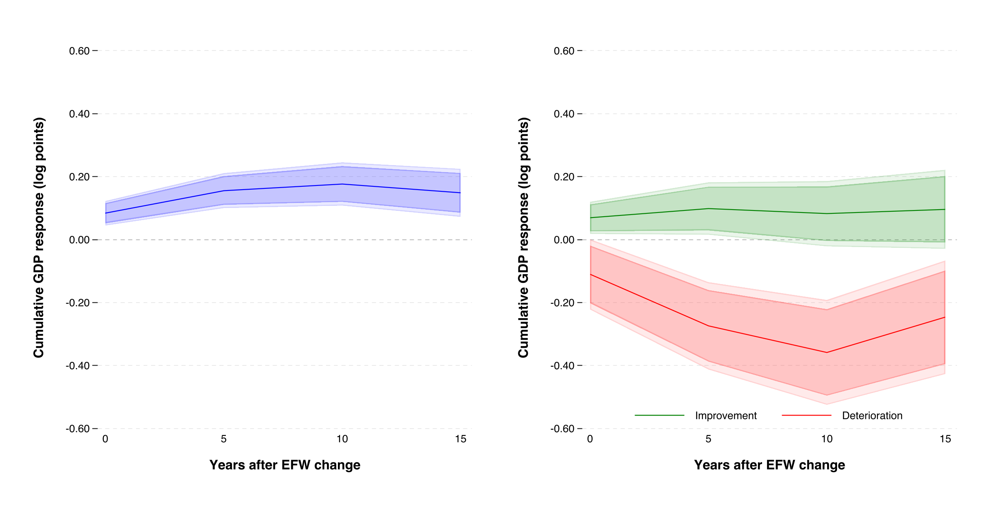

<h1 align="center">Economic freedom and firm entry–exit decisions</h1>

<p align="center">
  <strong>Gabriel Saco</strong><br>
  Professor Alexander Quispe · Universidad del Pacífico<br>
  <sub>AI and Economic Modeling · Track B · Final presentation · November 2026</sub>
</p>

<p align="center">
  <a href="slides/final.pdf"></a>
  <a href="https://gsaco.github.io/ai-project/slides/topic.html"></a>
  <a href="proposal/proposal.pdf"></a>
  <a href="slides/topic.pdf"></a>
</p>

<p align="center">
  <a href="https://chatgpt.com/s/cx_6acbfdd3fe208191925b8c885b7b051e">AI conversation</a> &nbsp;·&nbsp;
  <a href="prompts.md">Raw prompts</a> &nbsp;·&nbsp;
  <a href="proposal/topic-checklist.md">Reading and build guide</a>
</p>


---

> **Question** · Can equal temporary institutional improvements and deteriorations generate unequal output gains and losses?

<p align="center"><a href="figures/paper_main_figure.pdf"></a></p>

*Thesis evidence motivating the model. [Measurement and confidence bands](figures/README.md).*

## Model and conditional result

The initially active firm chooses activity $`a_t\in\{0,1\}`$ and input $`x_t\geq0`$; input is zero when closed. Usable property is $`s_t\bar k`$, with fixed $`\bar k=1`$. Output price is one:

```math
\max_{\{a_t,x_t\}}\sum_{t\geq0}\beta^t
\left[As_t^{1-\alpha}x_t^\alpha-wx_t-(F+c_0)a_t-\kappa a_t(1-a_{t-1})\right].
```

Maintain $`A,w,F>0`$, $`c_0\geq0`$, $`0<\alpha,\beta<1`$, and $`a_{-1}=1`$. All prices, technology and costs are fixed across paths. Financing is available; input does not affect future states. Closure is free, has no salvage, preserves physical property and dismantles the organization. Inactivity pays zero; every restart costs $`\kappa\geq0`$. The main model excludes organization-preserving suspension, entry and reallocation.

At date zero compare $`s_0-d`$, $`s_0`$ and $`s_0+d`$, with $`0<d<s_0`$ and $`s_0+d\leq1`$. All paths return permanently to $`s_0`$ at date one, as known in advance; $`c=c_0`$ throughout.

The unchanged input FOC is $`\alpha As^{1-\alpha}x^{\alpha-1}=w`$. It yields $`q(s)=sA(\alpha A/w)^{\alpha/(1-\alpha)}`$ and $`\pi(s,c_0)=(1-\alpha)q(s)-F-c_0`$. Write $`q_0=q(s_0)`$, $`\pi_0=\pi(s_0,c_0)`$ and $`\pi_-=\pi(s_0-d,c_0)`$.

**Proposition 1.** Under these maintained assumptions, if

```math
\pi_0>0,\qquad \pi_-+\beta V<0,\qquad \kappa>V,
\qquad V=\frac{\pi_0}{1-\beta},
```

only the adverse firm closes, and it never restarts. Relative to no change, impact loss $`q_0`$ exceeds gain $`(d/s_0)q_0`$; later the loss remains $`q_0`$ and the gain is zero. With free restarting the same impact closure occurs, but production recovers at date one. **Restart costs change recovery.** Cheap suspension costing $`h<\beta V`$ removes persistence. These are firm-level results, not estimates of an EFW or GDP effect.

## Materials and status

| Material | Files | Status |
|:--|:--|:--|
| Final presentation | [PDF](slides/final.pdf) · [LaTeX](slides/final.tex) · [Interactive HTML](slides/final.html) · [Quarto](slides/final.qmd) | 26 talk slides + 3 backups; handwritten revision and acceptance included |
| Working paper | [PDF](paper/paper.pdf) · [LaTeX](paper/paper.tex) | Eight-page argument + Lean appendix; proofs, feasibility, switching and suspension |
| Numerical checks | [Instructions](code/README.md) · [Results](code/output/final-verification.json) | Original and final checks; Python/browser comparisons |
| Lean | [Artifacts](lean/) · [Presentation checklist](paper/audit/final-presentation-checklist.md) | Six compiled counterparts; fast check passed; [scope and open bridge](paper/audit/lean-run.md) |
| Independent review | [Worksheet](hand/final/independent-check.md) · [Adjudication record](paper/audit/final-ai-log.md) | Original handwritten revision and verbatim acceptance supplied |
| October submission | [Proposal](proposal/proposal.pdf) · [Topic PDF](slides/topic.pdf) · [Interactive topic](https://gsaco.github.io/ai-project/slides/topic.html) | Preserved earlier submission |
| AI collaboration | [Raw conversation log](prompts.md) · [Selected final exchanges](prompts-final.md) | AI explanations distinguished from my own assessment |

The [interactive final presentation](slides/final.html) is self-contained: download it and open it in a browser. The [course checklist](paper/audit/final-presentation-checklist.md) maps the eight required presentation points to slides; the [branch review](paper/audit/branch-review.md) lists verification and remaining work. Entry, heterogeneous-firm equilibrium, empirical calibration, and the full handwritten appendix remain open. [Course requirements](https://github.com/alexanderquispe/AI-Econ-Modeling/issues/7).
