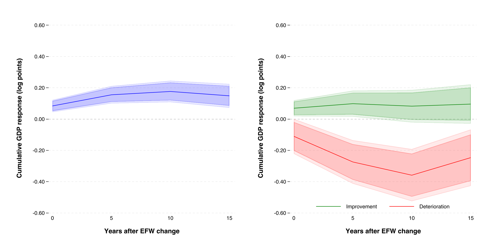
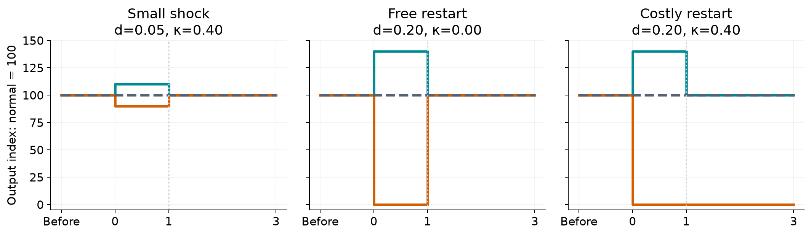
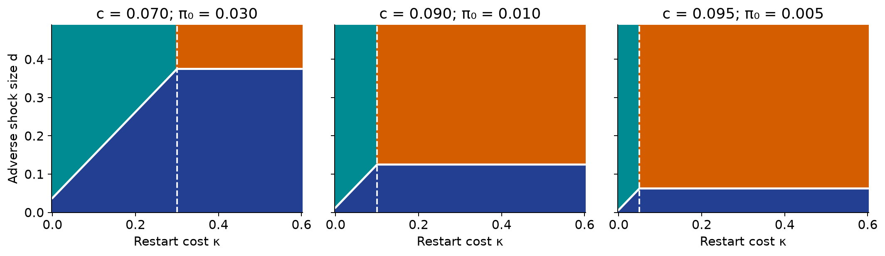
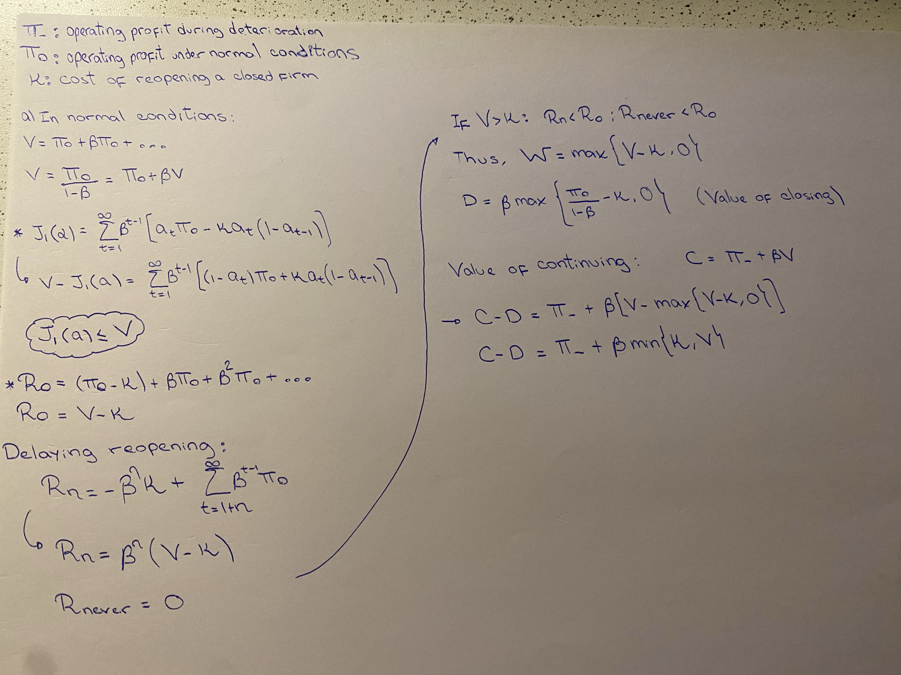

## {.cover #opening}


::: {.institution}


Universidad del Pacífico


:::


::: {.course}


AI and Economic Modeling · Final presentation · Track B


:::


```{=html}
<div class="logo"></div>
<h1>Economic freedom and<br><span class="blue">firm entry–exit decisions</span></h1>
```


::: {.byline}


Gabriel Saco


:::


::: {.professor}


Professor: Alexander Quispe


:::


::: {.repo}


[github.com/gsaco/ai-project](https://github.com/gsaco/ai-project)


:::


::: {.date}


Lima · November 11, 2026


:::


## Why might [losses]{.orange} exceed [gains]{.teal}? (Average responses of 160 countries) {#question .empirical-slide}


::: {.kicker}


01 · Question and thesis evidence


:::


```{=html}
<div class="empirical-figure" role="group" aria-label="Empirical GDP responses to economic-freedom changes">
<div class="empirical-panel-labels"><span>Symmetry imposed</span><span>Asymmetry allowed</span></div>

</div>
```

## The question and the [conditional result]{.orange} {#result}


::: {.kicker}

1 · Question and conditional result

:::


<h3>Can equal institutional changes have unequal output effects?</h3>


::: {.lead .contrast}

If a temporary deterioration makes the value of continuing negative and restarting costs more than the restored business is worth, its output loss exceeds the gain from an equal improvement and persists after institutions recover.

:::


::: {.two .rule}


::: {.card .orange-card}

<h3>Impact asymmetry</h3>
Closure creates a discrete output loss.

:::


::: {.card}

<h3>Persistence</h3>
Costly rebuilding prevents recovery.

:::


:::


::: {.takeaway}

A conditional firm-level mechanism. It does not identify the thesis's aggregate coefficients.

:::


## From economic freedom to [two firm-level channels]{.teal} {#institutions}


::: {.kicker}


02 · Institutional channels


:::


::: {.efw-intro}


Economic freedom concerns the ability to use property, make contracts, and exchange. The Economic Freedom of the World (EFW) index measures several institutional dimensions.


:::


```{=html}
<table class="efw-areas" aria-label="The five areas of the Economic Freedom of the World index">
<caption>Five areas of the EFW index <a href="https://efotw.org/economic-freedom/approach" target="_blank" rel="noopener noreferrer">Fraser Institute ↗</a></caption>
<thead><tr><th scope="col">Area 1</th><th scope="col">Area 2</th><th scope="col">Area 3</th><th scope="col">Area 4</th><th scope="col">Area 5</th></tr></thead>
<tbody><tr><td>Size of<br>government</td><td>Legal system and<br>property rights</td><td>Sound<br>money</td><td>Freedom to trade<br>internationally</td><td>Regulation</td></tr></tbody>
</table>
```


::: {.two .institution-channels}


::: {.card}


<span class="symbol">s</span>
**Institutionally usable property**


::: {.small}


Share of existing property available for productive use under prevailing institutional conditions. Title disputes or restrictions on property use can make premises unavailable.


:::


::: {.small .orange}


Less usable property: $s\downarrow$


:::


:::


::: {.card .orange-card}


<span class="symbol orange">c</span>
**Institution-related operating overhead**


::: {.small}


Recurring institutional expenses paid while operating, independently of current output. Examples include permit renewals and fixed costs of reporting or customs administration.


:::


::: {.small .orange}


Higher operating overhead: $c\uparrow$


:::


:::


:::


## From [usable property]{.teal} to production {#production}


::: {.kicker}


02 · Operating profit


:::


::: {.property-chain}


::: {.property-part}


<h3>Fixed property</h3>

$$\bar k>0$$

The firm's existing stock.


:::


::: {.property-operator}


$\times$


:::


::: {.property-part}


<h3>Usable share</h3>

$$s\in(0,1]$$

Determined by institutions.


:::


::: {.property-operator}


$=$


:::


::: {.property-part .usable-part}


<h3>Usable property</h3>

$$s\bar k$$

Available for production.


:::


:::


::: {.two .production-panels}


::: {.production-technology}


<h3>1 · Combine property with input</h3>

Assume Cobb–Douglas production:

$$q=A(s\bar k)^{1-\alpha}x^\alpha.$$


::: {.production-parameters}


$x\geq0$: variable input.<br>
$A>0$: productivity.<br>
$0<\alpha<1$: output elasticity of $x$.

Output sells for one, so output equals revenue.


:::


:::


::: {.production-units}


<h3>2 · Choose convenient units</h3>

Measure property in units of the firm's fixed stock: $\bar k=1$.

$$\boxed{q=As^{1-\alpha}x^\alpha.}$$

```{=html}
<div class="property-example">
<div class="property-example-label"><span>Example: s = 0.5</span><span>Fixed stock = 1</span></div>
<div class="property-share-bar" role="img" aria-label="Half the fixed property stock is usable: s equals 0.5 and the total stock is one."><span class="share-usable">Usable</span><span class="share-unavailable">Unavailable</span></div>
<p>Half the existing stock is available for production.</p>
</div>
```


:::


:::


::: {.takeaway}


An institutional shock changes the usable share $s$. The physical stock $\bar k$ stays fixed.


:::


## One experiment, [one changed assumption]{.teal} {#setup}


::: {.kicker}


02 · Baseline and model assumptions


:::


::: {.two .setup-baselines}


::: {.card}


<h3>Baseline: free restarting</h3>

$$\kappa=0$$


:::


::: {.card}


<h3>Extension: costly restarting</h3>

$$\kappa>0$$


:::


:::


| Institutional path | Shock: $t=0$ | Restored: $t\geq1$ |
|:--|:--:|:--:|
| Deterioration | $s_0-d$ | $s_0$ |
| No change | $s_0$ | $s_0$ |
| Improvement | $s_0+d$ | $s_0$ |


## The complete [firm problem]{.teal} {#formal-problem}


::: {.kicker}


02 · Choices and objective


:::


::: {.two .firm-choices}


::: {.choice-card}


<h3>Activity · $a_t\in\{0,1\}$</h3>

$1$: open. $0$: closed. Initially, $a_{-1}=1$.


:::


::: {.choice-card}


<h3>Variable input · $x_t\geq0$</h3>

Choose input when open; set $x_t=0$ when closed.


:::


:::


::: {.firm-objective}


<h3>Choose activity and input over time to maximize firm value</h3>

$$\max_{\{a_t,x_t\}}\sum_{t=0}^{\infty}\beta^t\left[
 As_t^{1-\alpha}x_t^\alpha-wx_t-(F+c_0)a_t-\kappa a_t(1-a_{t-1})\right].$$


:::


::: {.firm-components}


::: {.component-card .revenue-component}


<h3>Revenue</h3>

$$As_t^{1-\alpha}x_t^\alpha$$

$A>0$ is productivity. Output price is one, so output equals revenue.


:::


::: {.component-card}


<h3>Input bill</h3>

$$wx_t$$

Input quantity $x_t$ times its fixed unit price $w>0$.


:::


::: {.component-card}


<h3>Operating overhead</h3>

$$(F+c_0)a_t$$

$F>0$: ordinary fixed cost.<br>
$c_0\geq0$: institutional overhead.<br>
Both are paid only when open.


:::


::: {.component-card .restart-component}


<h3>Restart cost</h3>

$$\kappa a_t(1-a_{t-1})$$

Pay $\kappa\geq0$ only when closed last period and open now. Otherwise, pay zero.


:::


:::


## Optimal input and [operating profit]{.teal} {#optimum}


::: {.kicker}

2 · Model: solve the continuous choice first

:::


::: {.two}


::: {.card}

<h3>1 · Differentiate when operating</h3>
$$\alpha As^{1-\alpha}x^{\alpha-1}=w.$$
The marginal revenue product equals the input price. Strict concavity gives the unique optimum.

<h3>2 · Rearrange the FOC</h3>
$$x^*(s)=s(\alpha A/w)^{1/(1-\alpha)}.$$

:::


::: {.card}

<h3>3 · Substitute and use <span class="math inline">wx^*=\alpha q</span></h3>
$$q(s)=sA(\alpha A/w)^{\alpha/(1-\alpha)},$$
$$\pi(s,c_0)=(1-\alpha)q(s)-F-c_0.$$

Actual output is $y_t=a_tq(s_t)$.

Normal values: $q_0=q(s_0)$ and $\pi_0=\pi(s_0,c_0)$.

Shock profits: $\pi_\pm=\pi(s_0\pm d,c_0)$.

:::


:::


::: {.takeaway}

The input FOC is unchanged by $\kappa$: restarting is independent of input, and input does not change tomorrow's state.

:::


## Proposition: a temporary setback, a [lasting loss]{.orange} {#proposition}


::: {.kicker}

3 · Proposition 1 in the working paper

:::


::: {.three .conditions}


::: {.card}

<h3>Normal viability</h3>
$$\pi_0>0$$
Normal operation pays.

:::


::: {.card}

<h3>Continuation loses value</h3>
$$\pi_-+\beta V<0$$
Future profits cannot offset the current loss.

:::


::: {.card .orange-card}

<h3>Restart is unprofitable</h3>
$$\kappa>V$$
Rebuilding exceeds the restored value.

:::


:::

$$V=\frac{\pi_0}{1-\beta}>0.$$

::: {.takeaway}

Unique optimal paths: $a_t^-=0$ and $a_t^0=a_t^+=1$ for every $t\geq0$.

:::


## What changes: [persistence]{.orange}, not impact closure {#comparison}


::: {.kicker}

3 · Output comparison and the free-restart baseline

:::


$$L_t=y_t^0-y_t^-,\qquad G_t=y_t^+-y_t^0.$$

| | Impact loss $L_0$ | Impact gain $G_0$ | Loss after restoration |
|:--|:--:|:--:|:--:|
| Costly restart: $\kappa>V$ | $q_0$ | $(d/s_0)q_0$ | $q_0$ |
| Free restart: $\kappa=0$ | $q_0$ | $(d/s_0)q_0$ | $0$ |

In both cases $L_0>G_0$ because $d<s_0$. After restoration, $G_t=0$ in both cases.


::: {.takeaway}

The same adverse firm closes on impact in both experiments. Free restarting permits recovery at date one.

:::


## Proof roadmap: [three decisions, one comparison]{.teal} {#proof}


::: {.kicker}

4 · Proof progress

:::


1. **Input:** strict concavity gives $x^*(s)$, $q(s)$, and $\pi(s,c_0)$.
2. **After restoration:** solve the active and inactive firm's values, including every possible restart date.
3. **At date zero:** compare continuing with closing while retaining the option to reopen.
4. **Output:** apply the activity paths to the linear operating-output function $q(s)$.


::: {.takeaway}

The delicate step is the value of closing. Zero is always feasible; it is not always the best value.

:::


## Waiting cannot improve the [restart value]{.teal} {#delay}


::: {.kicker}

4 · Lemma 2: all restart dates, including never

:::


::: {.two}


::: {.card}

<h3>1 · Active at a restored date</h3>
$$V=\pi_0+\beta\pi_0+\cdots=\frac{\pi_0}{1-\beta}.$$
Closing forgoes positive profits and could add another restart bill.

<h3>2 · Closed at a restored date</h3>
Restart after $n\geq0$ periods, then stay open:
$$\beta^n(V-\kappa).$$
Never restart: value zero.

:::


::: {.card}

<h3>3 · Compare every delay</h3>
$V>\kappa$: discounting reduces a positive payoff; restart immediately.

$V<\kappa$: every finite delay gives a negative payoff; never restart.

$V=\kappa$: all restart dates and never restarting tie.
$$W=\max\{V-\kappa,0\}.$$

:::


:::


::: {.takeaway}

Once restarted, further closures cannot help because $\pi_0>0$ and $\kappa\geq0$. This covers repeated switching too.

:::


## Closure retains an [option to reopen]{.teal} {#closure}


::: {.kicker}

4 · Compare values at the same date

:::


::: {.two}


::: {.contrast}

<h3>Keep operating at date zero</h3>
$$\pi_j+\beta V$$
Current profit plus restored business value.

:::


::: {.contrast .orange-card}

<h3>Close at date zero</h3>
$$\beta\max\{V-\kappa,0\}$$
Zero current payoff plus the option to restart.

:::


:::


<h3>Under the proposition's strict conditions</h3>
$\kappa>V$ makes closing worth zero. Adverse continuation is negative, so closure is optimal. Normal continuation is $V>0$; favorable continuation is even larger.

With $\kappa=0$, closure is worth $\beta V$. Since $\pi_-<0$, the adverse firm still closes, but reopens at date one.


::: {.takeaway}

$a_t$ is binary: its optimality condition is a value comparison, not a derivative with respect to activity.

:::


## The conditions [can hold together]{.teal} {#feasibility}


::: {.kicker}

4 · Nonempty parameter region

:::


::: {.small}

$A=2$, $\alpha=0.5$, $w=1.25$, $F=0.30$, $c_0=0.09$, $s_0=0.50$, $d=0.20$, $\beta=0.90$, $\kappa=0.40$.

:::


::: {.two .rule}


::: {.card}

<h3>Compute from the primitives</h3>
$$q_0=0.80,\quad\pi_0=0.01,\quad V=0.10,$$
$$\pi_-=-0.15,\qquad\pi_+=0.17.$$
<h3>Check the inequalities</h3>
$$\pi_-+\beta V=-0.06<0,\quad\kappa>V.$$

:::


::: {.card}

<h3>Why a thin margin matters</h3>
Permanent closure requires
$$\frac{\pi_0}{(1-\alpha)q_0}<(1-\beta)\frac d{s_0}.$$
Here $0.025<0.04$. Normal operation is profitable, but future earnings are small relative to the shock loss.

:::


:::


::: {.takeaway}

All inequalities are strict: a neighborhood of this example also satisfies the proposition. The result is not universal.

:::


## Proof status: [done]{.teal}, difficult, open {#proof-status}


::: {.kicker}

4 · Analytic proofs versus remaining research

:::


::: {.three}


::: {.card}

<h3>Proved in the paper</h3>
Unique input optimum.

All delayed restart values.

Strict persistence and the complete closure threshold.

Cheap-suspension threshold.

:::


::: {.card}

<h3>The difficult step</h3>
Accounting for closure's option value.

Ruling out arbitrary delay and repeated switching.

Separating impact from recovery.

:::


::: {.card .orange-card}

<h3>Still open</h3>
Entry and reallocation.

A heterogeneous-firm equilibrium.

Empirical measurement of restart and preservation costs.

Independent assessment of the remaining AI contributions.

:::


:::


::: {.takeaway}

Analytic completion, numerical checks, Lean coverage, and independent author review are separate claims.

:::


## Three reproduced cases: [same model]{.teal} {#cases}


::: {.kicker}

5 · Numerical illustrations, not calibration

:::


{.wide-figure alt="Three output paths: small shocks preserve activity; large adverse shocks close the firm; free restart restores output while costly restart prevents recovery."}


::: {.chart-key}

<span class="teal">Improvement</span><span class="orange">Deterioration</span><span class="baseline">No change (dashed)</span>

:::


::: {.takeaway}

Small shocks: keep operating. Large shocks: close. Restart costs distinguish recovery from permanent inactivity.

:::


## Where does each [operating regime]{.orange} occur? {#regimes}


::: {.kicker}

5 · Proposition 2 and parameter comparisons

:::


Strict closure if
$$ (1-\alpha)q_0\frac d{s_0}>\pi_0+\beta\min\{\kappa,V\}. $$

{.regime-figure alt="Shock size versus restart cost, at three overhead levels: operating, closure with reopening, and permanent closure regions."}


::: {.chart-key}

<span class="blue">Keep operating</span><span class="teal">Close and reopen</span><span class="orange">Close permanently</span>

:::


::: {.takeaway}

Higher $\kappa$ can discourage closure today; higher $c_0$ lowers margins and expands permanent closure. White curves: closure indifference. Dashed lines: $\kappa=V$.

:::


## Explore the [decision margins]{.teal} {#experiment}


::: {.kicker}

5 · Shock, restart cost, and normal overhead

:::


```{=html}
<div class="final-explorer">
<div class="controls-panel">
<label for="final-d">Shock size d <output id="out-d">0.20</output></label><input id="final-d" type="range" min="0.01" max="0.49" step="0.01" value="0.20">
<label for="final-k">Restart cost κ <output id="out-k">0.40</output></label><input id="final-k" type="range" min="0" max="0.60" step="0.01" value="0.40">
<label for="final-c">Normal overhead c₀ <output id="out-c">0.090</output></label><input id="final-c" type="range" min="0.05" max="0.099" step="0.001" value="0.09">
<p class="fine">c₀ stays fixed across the three shock paths.</p>
<div class="final-presets"><button data-case="small">Small shock</button><button data-case="free">Free restart</button><button data-case="costly" aria-pressed="true">Costly restart</button><button data-case="margin">Stronger margin</button><button data-case="avoid">Avoid restarting</button></div>
</div>
<div>
<div class="chart-key"><span class="teal">Improvement</span><span class="orange">Deterioration</span><span class="baseline">No change</span></div>
<svg id="final-paths" viewBox="0 0 1000 360" role="img" aria-label="Interactive output comparison"></svg>
<div class="final-values"><div>Operate now<strong id="value-operate"></strong></div><div>Close now<strong id="value-close"></strong></div><div>Restart later: V − κ<strong id="value-restart"></strong></div></div>
<p id="final-decision" class="insight" aria-live="polite"></p>
<p id="final-losses" class="fine"></p>
</div></div>
```

## First robustness test: [cheap suspension]{.teal} {#suspension}


::: {.kicker}

5 · Proposition 3: preserve the organization for a cost h

:::


::: {.small}

At date zero, suspension produces nothing, costs $h\geq0$ in total, and preserves the organization for free resumption at date one. It replaces operating overhead for that period.

:::

$$\text{Suspend: }-h+\beta V;\quad\text{close: }0;\quad\text{operate: }\pi_-+\beta V<0.$$
```{=html}
<div class="suspension-explorer"><div><label for="final-h">Preservation cost h <output id="out-h">0.02</output></label><input id="final-h" type="range" min="0" max="0.15" step="0.005" value="0.02"><p id="suspend-choice" class="insight" aria-live="polite"></p></div><svg id="suspension-plot" viewBox="0 0 1000 280" role="img" aria-label="Values of operating, closing and suspending"></svg></div>
```

::: {.takeaway}

If $h<\beta V$, suspension strictly wins. Impact loss remains, but output fully recovers at date one. At $h=\beta V$, suspension and closure tie.

:::


## What the calculations [check]{.teal} and leave open {#scope}


::: {.kicker}

5 · Scope of the numerical evidence

:::


::: {.two}


::: {.card}

<h3>Checked</h3>
Symbolic FOC and numerical input optimum.

Three topic cases reproduced.

168 parameter points: compare closed-form decisions with all five-date activity sequences and an exact stationary tail.

151 suspension costs; delay, tie, and browser/Python checks.

:::


::: {.card .orange-card}

<h3>Not established by those checks</h3>
A finite grid is not a proof over all parameters.

No estimated EFW shock or calibrated GDP effect.

Entry and heterogeneity remain open: $\kappa>V$ does not exclude favorable date-zero entry.

Fixed-cohort totals are accounting, not general equilibrium.

:::


:::


::: {.takeaway}

Even when $\kappa>V$, an otherwise identical inactive owner can enter during the improvement if $\pi_++\beta V-\kappa>0$. Entry and reallocation can alter the aggregate comparison.

:::


## Lean checks [every possible restart path]{.teal} {#lean-statement}

::: {.kicker}
6 · Paper statement, Lean statement, and proof excerpt
:::

:::: {.columns}
::: {.column width="35%"}

<h3>Paper: Lemma 2, costly-restart clause</h3>

Under A1–A6, “permanent inactivity is uniquely optimal if $V<\kappa$.”

$$V=\frac{\pi_0}{1-\beta},\qquad \pi_0>0,\quad 0<\beta<1.$$

<h3>Read the formal statement</h3>

`pi` is $\pi_0$; `false` means initially closed.

`a` is any infinite sequence of activity choices.

The maximum is zero. Only the never-restart path attains it.

:::
::: {.column width="62%"}

<h3>Actual Lean statement</h3>

```lean
lemma restored_inactive_optimal_iff_inactive {pi beta kappa : ℝ}
    (hpi : 0 < pi) (hbeta0 : 0 < beta) (hbeta1 : beta < 1)
    (hkappa : 0 ≤ kappa) (hkgt : pi / (1 - beta) < kappa)
    (a : ActivityPath) :
    restoredPathValue pi beta kappa false a =
      max (pi / (1 - beta) - kappa) 0 ↔ a = alwaysInactive := by
```

<h3>Proof excerpt: equality forces the inactive path</h3>

```lean
  rw [restoredPathValue_eq_potential_iff_slack_zero
    hpi hbeta0 hbeta1 hkappa]
  constructor
  · exact tight_inactive_forces_inactive
      hpi hbeta0 hbeta1 hkappa hkgt a
```

[Source: `lean/MainTheorems.lean`; statement line breaks adapted.]{.small}

:::
::::

::: {.takeaway}
The proof bounds the infinite discounted payoff of every path. Equality requires no profitable decision to be forgone at any date; here that forces permanent inactivity.
:::


## Lean: [verified scope]{.teal} and the remaining gap {#lean-proof}

::: {.kicker}
6 · Compiling a proof and checking its economic meaning are different tasks
:::

:::: {.columns}
::: {.column width="48%"}
<h3>What has compiled</h3>

Six formal counterparts of the paper's numbered results, with no `sorry`.

The input optimum and the reduced activity problem, including arbitrary infinite paths.

Switching thresholds, suspension comparisons, and positive-total log comparisons.
:::

::: {.column width="48%"}
<h3><span class="orange">What remains open</span></h3>

The formal bridge from joint input/activity maximization to the reduced activity problem.

This includes unoptimized plans whose discounted losses are infinite.

The required fast check passed. Full source-correspondence certification remains incomplete.
:::
::::

::: {.small}
Paper version: merged commit `a15ed978`. Complete declarations and command records accompany the paper.
:::

::: {.takeaway}
Lean checks the specified input and reduced dynamic problems. I do not yet claim verification of the full original optimization problem.
:::

## The AI-assisted step I [checked by hand]{.orange} {#ai-check}


::: {.kicker}

7 · Selected derivation: closure with an option to reopen

:::


1. At date one, immediate restarting yields $V-\kappa$.
2. Restarting $n$ periods later yields $\beta^n(V-\kappa)$.
3. Include never restarting, with value zero.
4. Compare positive, zero, and negative $V-\kappa$; discount the best value once to date zero.

$$\text{Closing value at date zero}=\beta\max\{V-\kappa,0\}.$$

::: {.takeaway}

An AI-generated uniqueness helper allowed $\beta=0$: then future actions do not affect value. The paper already requires $\beta>0$. That diagnostic is separate from my handwritten closure-value check.

:::


## My handwritten check and [assessment]{.teal} {#handwritten}

::: {.kicker}
7 · My revision · November 9, 2026
:::

```{=html}
<div class="hand-review-layout">
<button type="button" class="hand-image-button hand-detail" aria-label="Enlarge my original handwritten revision">
  
</button>
<div class="hand-verdict">
<h3 class="teal">My verdict</h3>
<blockquote>I accept it.</blockquote>
<h3>The equivalence I checked</h3>
```

I initially suspected an error in the equivalence between the max and min expressions. My handwritten derivation confirmed:

$$\begin{aligned}V-\max\{V-\kappa,0\}\\=\min\{\kappa,V\}.\end{aligned}$$

```{=html}
<p class="hand-caption">Enlarged excerpt of my original photograph.<br>Click the image to inspect the complete page.</p>
</div>
</div>
```

## Three questions for [class discussion]{.teal} {#discussion}


::: {.kicker}

8 · Discussion: 15 minutes

:::


1. **Suspension:** what observable evidence would distinguish temporary shutdown from organization-destroying closure? Which costs should $h$ include?
2. **Aggregation:** what is the smallest model of heterogeneous firms, entry, and reallocation that could preserve the loss–gain comparison?
3. **Timing and margins:** should the next extension vary the duration of restoration or relax perfect foresight? How would we identify the fragile firms?

## Literature and [reproducible materials]{.teal} {#references}


::: {.kicker}

Sources and reproducibility

:::


**Dixit (1989).** [Entry and Exit Decisions under Uncertainty](https://doi.org/10.1086/261619). *JPE* 97(3), 620–638. Sunk costs and the distinction between incumbency and entry.

**Dixit (1992).** [Investment and Hysteresis](https://doi.org/10.1257/jep.6.1.107). *JEP* 6(1), 107–132. Suspension versus abandonment.

**Lawson, Murphy, and Mitchell (2025).** *Economic Freedom of the World*. Institutional measurement framework.

[github.com/gsaco/ai-project](https://github.com/gsaco/ai-project): working paper, code and check logs, Lean artifacts, and AI record. The October topic submission is preserved.


::: {.takeaway}

I use an established sunk-cost mechanism in a deterministic institutional experiment. The contribution is the precise conditional comparison and its limits.

:::


## Backup: [all switching regions and ties]{.teal} {#ties}


::: {.kicker}

Backup · Proposition 2

:::


<h3>Continuation minus closure value</h3>
$$\pi_-+\beta V-\beta\max\{V-\kappa,0\}
=\pi_0-(1-\alpha)q_0\frac d{s_0}+\beta\min\{\kappa,V\}.$$

A negative difference implies closure; a positive one implies operation; zero gives indifference.

After closure: $\kappa<V$ implies immediate restart; $\kappa>V$ implies never restarting; $\kappa=V$ allows any restart date or none.

Under every optimal selection, $L_t\geq G_t\geq0$. Strictness occurs at impact exactly when the adverse firm closes; later exactly when it remains closed.


::: {.takeaway}

Numerical convention: operate at a closure tie and decline a zero-value restart. The strict proposition is independent of this convention.

:::


## Backup: [logs require positive totals]{.teal} {#logs}


::: {.kicker}

Backup · Corollary 1

:::


<h3>A fixed-cohort accounting extension</h3>
$$Y_t^j=B+Ny_t^j,\qquad B>0,\quad N>0.$$
Under Proposition 1, strict level asymmetry implies
$$2Y_t^0>Y_t^-+Y_t^+\geq2\sqrt{Y_t^-Y_t^+},$$
$$(Y_t^0)^2>Y_t^-Y_t^+\quad\Longrightarrow\quad
\log Y_t^0-\log Y_t^->\log Y_t^+-\log Y_t^0.$$

Common population cancels from per-capita log differences. A closed firm's log output is undefined. Even symmetric level changes can be asymmetric in logs.


::: {.takeaway}

This is not a model of GDP: it holds background output and the cohort fixed and omits entry, prices, and reallocation.

:::


## Backup: my [original handwritten revision]{.teal} {#handwritten-original}

```{=html}
<button type="button" class="hand-image-button hand-full" aria-label="Enlarge the complete handwritten page">

</button>
```
