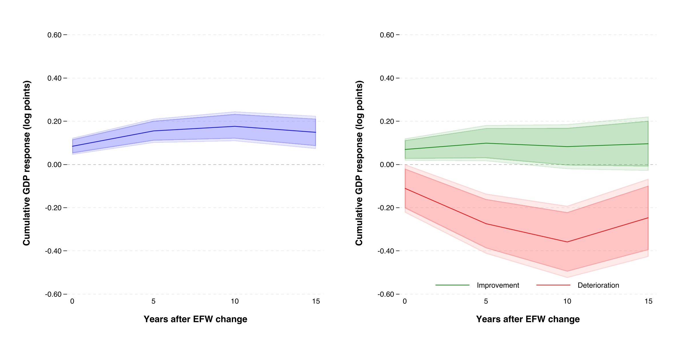

## {.cover #opening}

::: {.institution}

Universidad del Pacífico

:::

::: {.course}

AI and Economic Modeling · Track B: the model behind my thesis

:::

```{=html}
<div class="logo"></div>
<h1>Economic freedom and<br><span class="blue">firm entry–exit decisions</span></h1>
```

::: {.byline}

Gabriel Saco

:::

::: {.professor}

Professor: Alexander Quispe

:::

::: {.repo}

[github.com/gsaco/ai-project](https://github.com/gsaco/ai-project)

:::

::: {.date}

Lima · October 2026

:::

## Why might [losses]{.orange} exceed [gains]{.teal}? {#question .empirical-slide}

::: {.kicker}

01 · Question and thesis evidence

:::

```{=html}
<div class="empirical-figure" role="group" aria-label="Empirical GDP responses to economic-freedom changes">
<div class="empirical-panel-labels"><span>Symmetry imposed</span><span>Asymmetry allowed</span></div>

</div>
```

## From economic freedom to [two firm-level channels]{.teal} {#institutions}

::: {.kicker}

02 · Institutional channels

:::

::: {.efw-intro}

Economic freedom concerns the ability to use property, make contracts, and exchange. The Economic Freedom of the World (EFW) index measures several institutional dimensions.

:::

```{=html}
<table class="efw-areas" aria-label="The five areas of the Economic Freedom of the World index">
<caption>Five areas of the EFW index <a href="https://efotw.org/economic-freedom/approach" target="_blank" rel="noopener noreferrer">Fraser Institute ↗</a></caption>
<thead><tr><th scope="col">Area 1</th><th scope="col">Area 2</th><th scope="col">Area 3</th><th scope="col">Area 4</th><th scope="col">Area 5</th></tr></thead>
<tbody><tr><td>Size of<br>government</td><td>Legal system and<br>property rights</td><td>Sound<br>money</td><td>Freedom to trade<br>internationally</td><td>Regulation</td></tr></tbody>
</table>
```

::: {.two .institution-channels}

::: {.card}

<span class="symbol">s</span>
**Institutionally usable property**

::: {.small}

Share of existing property available for productive use under prevailing institutional conditions. Title disputes or restrictions on property use can make premises unavailable.

:::

::: {.small .orange}

Less usable property: $s\downarrow$

:::

:::

::: {.card .orange-card}

<span class="symbol orange">c</span>
**Institution-related operating overhead**

::: {.small}

Recurring institutional expenses paid while operating, independently of current output. Examples include permit renewals and fixed costs of reporting or customs administration.

:::

::: {.small .orange}

Higher operating overhead: $c\uparrow$

:::

:::

:::

## From [usable property]{.teal} to production {#production}

::: {.kicker}

02 · Operating profit

:::

::: {.property-chain}

::: {.property-part}

<h3>Fixed property</h3>

$$\bar k>0$$

The firm's existing stock.

:::

::: {.property-operator}

$\times$

:::

::: {.property-part}

<h3>Usable share</h3>

$$s\in(0,1]$$

Determined by institutions.

:::

::: {.property-operator}

$=$

:::

::: {.property-part .usable-part}

<h3>Usable property</h3>

$$s\bar k$$

Available for production.

:::

:::

::: {.two .production-panels}

::: {.production-technology}

<h3>1 · Combine property with input</h3>

Assume Cobb–Douglas production:

$$q=A(s\bar k)^{1-\alpha}x^\alpha.$$

::: {.production-parameters}

$x\geq0$: variable input.<br>
$A>0$: productivity.<br>
$0<\alpha<1$: output elasticity of $x$.

Output sells for one, so output equals revenue.

:::

:::

::: {.production-units}

<h3>2 · Choose convenient units</h3>

Measure property in units of the firm's fixed stock: $\bar k=1$.

$$\boxed{q=As^{1-\alpha}x^\alpha.}$$

```{=html}
<div class="property-example">
<div class="property-example-label"><span>Example: s = 0.5</span><span>Fixed stock = 1</span></div>
<div class="property-share-bar" role="img" aria-label="Half the fixed property stock is usable: s equals 0.5 and the total stock is one."><span class="share-usable">Usable</span><span class="share-unavailable">Unavailable</span></div>
<p>Half the existing stock is available for production.</p>
</div>
```

:::

:::

::: {.takeaway}

An institutional shock changes the usable share $s$. The physical stock $\bar k$ stays fixed.

:::

## One experiment, [one changed assumption]{.teal} {#setup}

::: {.kicker}

02 · Baseline and model assumptions

:::

::: {.two .setup-baselines}

::: {.card}

<h3>Baseline: free restarting</h3>

$$\kappa=0$$

:::

::: {.card}

<h3>Extension: costly restarting</h3>

$$\kappa>0$$

:::

:::

| Institutional path | Shock: $t=0$ | Restored: $t\geq1$ |
|:--|:--:|:--:|
| Deterioration | $s_0-d$ | $s_0$ |
| No change | $s_0$ | $s_0$ |
| Improvement | $s_0+d$ | $s_0$ |

::: {.two .setup-assumptions}

::: {}

<h3>Same firm and known restoration</h3>

Initially open; $0<d<s_0$, $s_0+d\leq1$. Restoration is permanent and known at date 0. Hold $c=c_0$ and other parameters fixed.

:::

::: {}

<h3>What closure means</h3>

Free closure preserves property but dismantles the organization. No organization-preserving suspension; financing is available. Profits are discounted by $0<\beta<1$.

:::

:::

## The complete [firm problem]{.teal} {#formal-problem}

::: {.kicker}

02 · Choices and objective

:::

::: {.two .firm-choices}

::: {.choice-card}

<h3>Activity · $a_t\in\{0,1\}$</h3>

$1$: open. $0$: closed. Initially, $a_{-1}=1$.

:::

::: {.choice-card}

<h3>Variable input · $x_t\geq0$</h3>

Choose input when open; set $x_t=0$ when closed.

:::

:::

::: {.firm-objective}

<h3>Choose activity and input over time to maximize firm value</h3>

$$\max_{\{a_t,x_t\}}\sum_{t=0}^{\infty}\beta^t\left[
 As_t^{1-\alpha}x_t^\alpha-wx_t-(F+c_t)a_t-\kappa a_t(1-a_{t-1})\right].$$

:::

::: {.firm-components}

::: {.component-card .revenue-component}

<h3>Revenue</h3>

$$As_t^{1-\alpha}x_t^\alpha$$

$A>0$ is productivity. Output price is one, so output equals revenue.

:::

::: {.component-card}

<h3>Input bill</h3>

$$wx_t$$

Input quantity $x_t$ times its fixed unit price $w>0$.

:::

::: {.component-card}

<h3>Operating overhead</h3>

$$(F+c_t)a_t$$

$F>0$: ordinary fixed cost.<br>
$c_t\geq0$: institutional overhead.<br>
Both are paid only when open.

:::

::: {.component-card .restart-component}

<h3>Restart cost</h3>

$$\kappa a_t(1-a_{t-1})$$

Pay $\kappa\geq0$ only when closed last period and open now. Otherwise, pay zero.

:::

:::

## Restart costs leave the [input FOC unchanged]{.teal} {#foc}

::: {.kicker}

03 · The expected first-order condition

:::

::: {.foc-start}

<h3>1 · Hold the operating decision fixed</h3>

Choose the variable input $x$ to maximize operating profit:

$$\pi(s,c)=\max_{x\geq0}\left\{As^{1-\alpha}x^\alpha-wx-F-c\right\}.$$

:::

::: {.two .foc-panels}

::: {.foc-derivative}

<h3>2 · Differentiate with respect to input</h3>

The slope of operating profit is:

$$\alpha As^{1-\alpha}x^{\alpha-1}-w.$$

An extra unit of input adds revenue and costs $w$.

:::

::: {.foc-optimum}

<h3>3 · Set the slope equal to zero</h3>

The first-order condition is:

$$\boxed{\alpha As^{1-\alpha}x^{\alpha-1}=w.}$$

Marginal revenue product = input price.

:::

:::

::: {.takeaway}

Diminishing returns give a unique optimum. The FOC is unchanged: rebuilding costs do not depend on $x$. The changed result concerns closure and recovery.

:::

## From [optimal input]{.teal} to output and profit {#solution}

::: {.kicker}

03 · From the FOC to the outcomes

:::

::: {.derivation-path}

::: {.derivation-row}

::: {.derivation-explanation}

<span class="derivation-number">1</span>
<h3>Choose input</h3>

Rearrange the FOC, then raise both sides to $1/(1-\alpha)$.

:::

::: {.derivation-equations}

$$\begin{aligned}
x^{1-\alpha}&=\frac{\alpha As^{1-\alpha}}{w}\\[5pt]
x^*(s)&=s\left(\frac{\alpha A}{w}\right)^{1/(1-\alpha)}.
\end{aligned}$$

:::

:::

::: {.derivation-row}

::: {.derivation-explanation}

<span class="derivation-number">2</span>
<h3>Compute output</h3>

Substitute the optimal input into production.

:::

::: {.derivation-equations}

$$q(s)=sA\left(\frac{\alpha A}{w}\right)^{\alpha/(1-\alpha)}.$$

:::

:::

::: {.derivation-row .profit-result}

::: {.derivation-explanation}

<span class="derivation-number">3</span>
<h3>Compute operating profit</h3>

Multiply the FOC by $x^*$:<br>
input spending is $wx^*=\alpha q$.

:::

::: {.derivation-equations}

$$\begin{aligned}
\pi(s,c)&=q(s)-wx^*(s)-F-c\\[5pt]
&=(1-\alpha)q(s)-F-c.
\end{aligned}$$

:::

:::

:::

::: {.takeaway}

$q(s_t)$ is output if operating. Actual output is $y_t=a_tq(s_t)$: $a_t=1$ if open and $0$ if closed.

:::

## Two channels, [different effects]{.teal} {#channels}

::: {.kicker}

03 · Operating profit: interactive figure

:::

```{=html}
<div class="interactive-layout">
<div class="controls-panel" id="channel-controls">
<div class="channel-presets">
<h3>1 · Choose a change</h3>
<button id="channel-legal" type="button">Less usable property</button>
<button id="channel-compliance" type="button">Higher overhead</button>
<button id="channel-reset" type="button">Reset to starting values</button>
</div>
<div class="channel-parameters">
<h3>2 · Adjust its size</h3>
<div class="control"><label for="channel-s">Usable property <i>s</i><output id="channel-s-value">0.50</output></label><input id="channel-s" type="range" min="0.1" max="1" step="0.01" value="0.5"></div>
<div class="control"><label for="channel-c" aria-label="Institution-related operating overhead c">Overhead <i>c</i><output id="channel-c-value">0.09</output></label><input id="channel-c" type="range" min="0" max="0.2" step="0.01" value="0.09"></div>
</div>
<p class="channel-scope">Choices shown are conditional on operating. Values are illustrative.</p>
</div>
<div class="channel-results">
<div class="channel-plot-panel">
<div class="channel-plot-heading"><h3>The firm chooses the peak</h3><div class="chart-key"><span class="baseline">Starting</span><span class="blue">Current</span></div></div>
<svg id="profit-chart" class="plot" viewBox="0 0 1080 285" role="img" aria-label="Operating profit as a function of input use, with the optimal input marked"></svg>
</div>
<div class="metrics" aria-live="polite"><div class="metric"><span class="name">Chosen input x*</span><b id="channel-x">0.32</b><span class="delta" id="channel-dx">No change</span></div><div class="metric"><span class="name">Operating output q</span><b id="channel-q" class="teal">0.80</b><span class="delta" id="channel-dq">No change</span></div><div class="metric"><span class="name">Operating profit π</span><b id="channel-pi">0.01</b><span class="delta" id="channel-dpi">No change</span></div></div>
<div class="accounting" aria-label="Revenue minus costs equals operating profit"><div>Revenue<b id="acct-revenue">0.80</b></div><em>−</em><div>Input bill<b id="acct-input">0.40</b></div><em>−</em><div>Overhead F<b>0.30</b></div><em>−</em><div>Overhead c<b id="acct-c">0.09</b></div><em>=</em><div>Profit<b id="acct-profit">0.01</b></div></div>
<div class="insight" id="channel-description" aria-live="polite">A thin-margin firm: operating profit is just 0.01.</div>
</div>
</div>
```

## [Closure today]{.orange} and [restarting later]{.teal} {#closure}

::: {.kicker}

03 · Expected result: closure and restarting

:::

::: {.closure-definitions}

::: {.value-card}

<h3>Normal operating profit</h3>

$$\pi_0=\pi(s_0,c_0)>0$$

:::

::: {.value-card .adverse-profit}

<h3>Profit during deterioration</h3>

$$\pi_-=\pi(s_0-d,c_0)$$

:::

::: {.value-card .business-value}

<h3>Normal business value</h3>

$$V=\pi_0+\beta\pi_0+\cdots$$
$$=\frac{\pi_0}{1-\beta},\qquad 0<\beta<1.$$

:::

:::

::: {.two .activity-comparison}

::: {.activity-option .continue-option}

<h3>Keep operating</h3>

$$\pi_-+\beta V$$

Current profit plus discounted future earnings.

:::

::: {.activity-option .close-option}

<h3>Close now</h3>

$$\beta\max\{V-\kappa,0\}$$

Closure is free; restarting remains an option.

:::

:::

::: {.restart-panel}

::: {.restart-explanation}

<h3>After institutions are restored</h3>

Closure preserves the property but dismantles the organization. Rebuilding the workforce and commercial relationships costs $\kappa$.

:::

::: {.restart-rule}

<h3>Net value of restarting: $V-\kappa$</h3>

::: {.restart-outcomes}

::: {.restart-positive}

$V>\kappa$<br>
Restart

:::

::: {.restart-negative}

$V<\kappa$<br>
Remain closed

:::

:::

:::

:::

## Conjecture: a temporary setback can cause a [lasting loss]{.orange} {#conjecture}

::: {.kicker}

03 · Expected result: conditions → decisions → output

:::

::: {.conjecture-intro}

<h3>1 · Conditions</h3>

Maintain the experiment and assumptions above. Improvement profit: $\pi_+=\pi(s_0+d,c_0)$.

:::

::: {.three .conjecture-condition-cards}

::: {.condition-card}

<h3>Profitable normal operation</h3>

$$\pi_0>0$$

The firm earns positive operating profit under normal conditions.

:::

::: {.condition-card .adverse-condition}

<h3>Continuation loses value</h3>

$$\pi_-+\beta V<0$$

Future earnings cannot offset the loss from continuing during deterioration.

:::

::: {.condition-card .restart-condition}

<h3>Rebuilding is too costly</h3>

$$\kappa>\pi_++\beta V$$

An identical inactive owner would not enter even during improvement.

:::

:::

::: {.two .conjecture-results}

::: {.conjecture-activity}

<h3>2 · Decisions</h3>

::: {.outcome-card .adverse-outcome}

<span class="outcome-label">Deterioration</span>

Close and never restart.

:::

::: {.outcome-card .favorable-outcome}

<span class="outcome-label">Improvement or no change</span>

Remain open.

:::

:::

::: {.conjecture-output}

<h3>3 · Output comparison</h3>

Normal operating output: $q_0=q(s_0)$.<br>
Losses and gains are relative to no change.

| When? | Loss | Gain |
|:--|:--:|:--:|
| During the shock | $q_0$ | $\dfrac{d}{s_0}q_0$ |
| After restoration | $q_0$ | $0$ |

:::

:::

::: {.takeaway .conjecture-takeaway}

Because $d<s_0$, the initial loss exceeds the gain. After restoration, the loss persists while the gain disappears.

:::

## [Institutions recover]{.teal}. Does production recover too? {#experiment}

::: {.kicker}

03 · Expected result: baseline comparison

:::

```{=html}
<div class="interactive-layout" id="shock-lab">
<div class="controls-panel experiment-controls">
<div class="scenario-controls">
<p class="case-label">Choose a case</p>
<div class="case-buttons" role="group" aria-label="Economic scenarios">
<button type="button" id="preset-small"><span class="case-number">01</span><span>Small shock</span></button>
<button type="button" id="preset-free"><span class="case-number">02</span><span>Free restart</span></button>
<button type="button" id="preset-conjecture"><span class="case-number">03</span><span>Costly restart</span></button>
</div>
<p class="control-help case-help">Cases 2 and 3 use the same shock. Only the restart cost changes.</p>
</div>
<div class="parameter-controls">
<p class="case-label">Adjust parameters</p>
<div class="control"><label for="shock-d">Shock size <i>d</i><output id="shock-d-value">20 pp</output></label><input id="shock-d" type="range" min="0" max="0.45" step="0.01" value="0.2" aria-describedby="shock-unit"><p id="shock-unit" class="control-help">Change in usable property, in percentage points.</p></div>
<div class="control"><label for="shock-kappa">Restart cost <i>κ</i><output id="shock-kappa-value">0.40</output></label><input id="shock-kappa" type="range" min="0" max="0.6" step="0.01" value="0.4" aria-describedby="restart-unit"><p id="restart-unit" class="control-help">Cost of rebuilding, in model units.</p></div>
</div>
</div>
<div class="experiment-results">
<div class="experiment-chart">
<div class="chart-key"><span class="orange">■ Deterioration</span><span class="baseline">◇ No change</span><span class="teal">● Improvement</span></div>
<svg id="output-chart" class="plot" viewBox="0 0 1080 405" role="img" aria-labelledby="path-title path-description"></svg>
</div>
<div class="firm-caption">Firm under deterioration</div>
<div class="firm-history" aria-live="polite" aria-label="Activity and decisions of the firm under deterioration">
<div class="firm-start"><small>Before the shock</small><strong>Open</strong></div>
<span class="history-arrow" aria-hidden="true">→</span>
<div class="decision-stage"><small>During the shock · date 0</small><div class="decision-options"><span id="choice-continue" class="decision-option" tabindex="0">Keep operating</span><span id="choice-close" class="decision-option" tabindex="0">Close</span></div></div>
<span class="history-arrow" aria-hidden="true">→</span>
<div class="decision-stage"><small id="restart-context">After restoration · if closed</small><div class="decision-options" id="restart-options"><span id="choice-restart" class="decision-option" tabindex="0">Restart</span><span id="choice-stay-closed" class="decision-option" tabindex="0">Remain closed</span></div><strong id="stays-open" hidden>Still operating</strong></div>
</div>
<div id="shock-decision" class="insight" aria-live="polite">Institutions recover; the firm remains closed because restarting is unprofitable.</div>
</div>
</div>
```

## Prior work and [my proposed contribution]{.teal} {#literature}

::: {.kicker}

04 · Literature check and contribution

:::

::: {.two .literature-columns}

::: {.card}

<h3>Established mechanism</h3>

[Dixit (1989), pp. 621, 623, 629](https://doi.org/10.1086/261619): organizational decay, temporary reversals, and tolerating losses to avoid rebuilding.

[Dixit (1992), pp. 119–120](https://doi.org/10.1257/jep.6.1.107): suspension differs from abandonment. Its appendix (pp. 129–131) sets out the stochastic switching equations.

[Roberts & Tybout (1997)](https://pure.psu.edu/en/publications/the-decision-to-export-in-colombia-an-empirical-model-of-entry-wi/): evidence of sunk entry costs in exporting; not a test of EFW shocks. Review limited to the author-institution abstract.

:::

::: {.card}

<h3>Scope of the literature review</h3>

Dixit’s pp. 625 and 630 refer to appendices A/B available from the author; the published article does not include them.

[Princeton paper 91 (1988)](https://econpapers.repec.org/RePEc:fth:prinec:91) is catalogued, with no downloadable text there. Their contents remain outside this review.

:::

:::

::: {.takeaway}

I retain costly rebuilding and use known institutional paths to derive the conditional loss–gain comparison. I will then test suspension and entry. This bounded review does not establish originality.

:::

## The mechanism and [next steps]{.teal} {#research}

::: {.kicker}

05 · Plan and risks

:::

::: {.mechanism-flow}

::: {.mechanism-stage}

<span class="stage-label">01 · Institutions</span>
<h3>Profitability changes</h3>

Usable property and recurring overhead affect operating profit.

:::

::: {.mechanism-stage .mechanism-exit}

<span class="stage-label">02 · Activity</span>
<h3>A firm may close</h3>

Equal shocks can lead to different activity decisions and output responses.

:::

::: {.mechanism-stage .mechanism-persistence}

<span class="stage-label">03 · Persistence</span>
<h3>Restoration may not suffice</h3>

Costly restarting can keep production below its original level.

:::

:::

<h3 class="research-heading">My research plan</h3>

::: {.three .research-tasks}

::: {.research-task}

<span class="task-label">Derive by hand</span>
<h3>Prove the mechanism</h3>

- Solve the input optimum.
- Compare operating, closing, and restarting.
- Prove the conditional output inequalities.

:::

::: {.research-task .simulation-task}

<span class="task-label">Simulate</span>
<h3>Test its reach</h3>

- Vary margins, shock size and duration, and restart costs.
- Allow cheap suspension, entry, and heterogeneous firms.

:::

::: {.research-task}

<span class="task-label">Formalize in Lean</span>
<h3>Verify the logic</h3>

- Optimizer and value identities.
- Switching rules and no delayed reentry.
- Conditional output inequalities; logs where output is positive.

:::

:::

::: {.fragile-assumption}

<h3>The step most likely to fail</h3>

A temporary shock may induce **cheap suspension**, without dismantling the organization and requiring costly rebuilding.

:::
